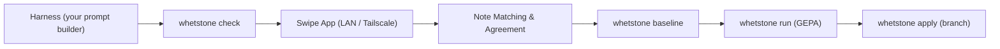

# Whetstone

[](https://github.com/Levonmov0/whetstone/actions/workflows/check.yml)

Test-driven prompt optimization as a Claude Code plugin: grade outputs on your phone, calibrate judges, and optimize with GEPA.

## Contents

- [Why Whetstone](#why-whetstone)
- [How It Works](#how-it-works)
- [Prerequisites & Setup](#prerequisites--setup)
- [Skills & CLI](#skills--cli)
- [Architecture & Verification](#architecture--verification)
- [Documentation](#documentation)

## Why Whetstone

Prompt changes are usually eyeball-and-guesswork: you tweak a string, check two examples, and hope nothing else regressed. Whetstone turns prompt work into test-driven development against your repo's real prompt builder, model parameters, and output schema without refactoring product code.

- **Real request harness:** Wraps your existing prompt builder in a stdin/stdout harness so tests use the exact messages, schema, and parameters production sends.
- **Mobile swipe grading:** Serves cards over LAN or Tailscale via QR code so you and teammates swipe good/bad/skip and attach free-text notes or reason chips.
- **Calibrated checks:** Combines deterministic Python checks (`checks/*.py`) with AI judges (`checks/*.judge.toml`, OpenAI or Cloudflare Workers AI) gated by agreement with human swipes.
- **Prompt-vs-model baseline:** Compares the current prompt across models in a blind deck before optimizing.
- **GEPA optimization & safe apply:** Rewrites only the marked editable block, evaluates on held-back cases, and applies winners onto a new git branch.

## How It Works



## Prerequisites & Setup

- **Python** `>=3.12` and [`uv`](https://docs.astral.sh/uv/)
- **Node.js** (for the swipe app's `jsdom` test suite)
- **Claude Code** (for the `/whetstone:*` plugin skills)

Clone and install dependencies:

```bash
git clone https://github.com/Levonmov0/whetstone.git
cd whetstone
uv sync --frozen
```

Verify the CLI works:

```bash
uv run whetstone --help
```

```text
usage: whetstone [-h]
                 {check,verify-harness,baseline,agreement,reasons,notes,map,disagreements,settle,serve,add-source,run,apply,apply-method} ...
```

To load Whetstone as a local Claude Code plugin, point Claude Code at this checkout (see `.claude-plugin/plugin.json`).

## Skills & CLI

| Skill | Purpose |
|---|---|
| `/whetstone:init` | Set up workspace, theme tokens, API keys, and verified harness |
| `/whetstone:new` | Interview and draft a new or repurposed prompt with a builder |
| `/whetstone:fix` | Triage a bad output or production failure into the optimization loop |
| `/whetstone:cases` | Calibrate and propose synthetic and edge-case test inputs |
| `/whetstone:grade` | Start the swipe server, show QR code, and match notes live |
| `/whetstone:checks` | Turn left-swipe reasons into code checks and calibrated AI judges |
| `/whetstone:run` | Run baseline/GEPA optimization with held-back evaluation |
| `/whetstone:apply` | Apply a winning candidate onto a new branch |

Key CLI subcommands:

- `whetstone check <prompt>` — run cases through the harness, model, and checks
- `whetstone baseline <prompt>` — compare models into one blind swipe deck
- `whetstone agreement <prompt>` — measure judge agreement against swipes
- `whetstone notes <prompt> [--follow]` / `whetstone map` — match grader notes to checks
- `whetstone run <prompt>` / `whetstone apply <prompt>` — optimize with GEPA and apply on a branch

## Architecture & Verification

Whetstone separates pure domain logic from I/O and SDKs across three layers, enforced in CI by [`import-linter`](.importlinter):

| Layer | Responsibility | Enforced Rule |
|---|---|---|
| `whetstone.entry` | CLI (`cli.py`), Starlette swipe server (`server.py`), static UI (`app.html`) | May call `features` and `platform`; no direct SDK imports |
| `whetstone.features` | Independent domain slices (`cases`, `checks`, `grading`, `matching`, `apply`, `optimize`, `workspace`) | Features never import each other; `core.py` modules are pure (no I/O or SDKs) |
| `whetstone.platform` | SDK and OS wrappers (Anthropic, OpenAI, Cloudflare Workers AI, GEPA, `flock` JSONL) | Only layer allowed to import external model/env SDKs |

Run the full check suite (strict `pyright`, `import-linter` contracts, `pytest`, and `jsdom` app tests):

```bash
make check
```

## Documentation

- [docs/workspace.md](docs/workspace.md) — workspace layout, `whetstone.toml`, `.env` keys, harness contract, check/judge formats, and `matches.jsonl` schema.
